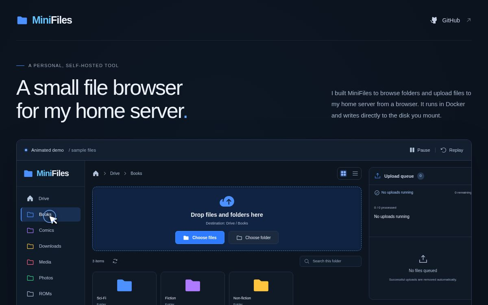

# MiniFiles

A small, self-hosted file browser for a home server. Browse a mounted drive, organise folder shortcuts, and upload files from a desktop browser. MiniFiles runs in Docker and writes uploads directly to the disk you mount.

[Project website](https://minifiles.metalogico.dev) · [Installation](docs/INSTALL.md) · [Development](docs/DEVELOPMENT.md)



## Features

- Browse folders with breadcrumbs, grid and list views, and search within the current folder.
- Add, edit and remove coloured folder shortcuts in Settings. Optionally create missing folders when adding a section.
- Upload individual files or whole folder trees through the picker or drag and drop. Paste files from the clipboard.
- Keep each upload's destination while navigating or opening Settings.
- Transfer one file at a time per page, with progress, finalisation status, errors and queue totals.
- Skip existing files automatically. MiniFiles never overwrites files; existing folders are reused.
- Cancel individual items, or finish the current file and discard the remaining queue.
- View filesystem disk usage and section sizes, refreshed at startup, at the end of a queue, or manually.
- Sign in with one configured account, protected by an HTTPS session cookie.
- Stream large uploads directly to disk with limited server memory use.

The interface is in English and designed for desktop screens at least 1100 px wide. Names you give files and sections are preserved. Download, preview, rename, move and delete operations are outside this version's scope. Interrupted uploads restart from the beginning.

## Install with Docker Compose

Docker image: **`ghcr.io/metalogico/minifiles:latest`**

Requires Docker with Compose 2.24.4 or newer. Images support `linux/amd64` and `linux/arm64`.

### Download the configuration

For a new installation:

```sh
mkdir minifiles
cd minifiles
curl -fL https://raw.githubusercontent.com/metalogico/minifiles/main/compose.yaml -o compose.yaml
curl -fL https://raw.githubusercontent.com/metalogico/minifiles/main/.env.example -o .env.example
cp .env.example .env
chmod 600 .env
mkdir -p local-data local-config
```

Already installed? Keep your `.env` and follow [Updating](#data-and-updates).

### Configure and start

Edit `.env` before starting:

1. Replace `MINIFILES_USERNAME` and `MINIFILES_PASSWORD` with your own credentials.
2. Set `MINIFILES_UID` and `MINIFILES_GID` to an identity that can write to both directories. On Linux, `id -u` and `id -g` show your current identity. Make the settings directory private with `chmod 700 local-config`.
3. For an existing drive, set `MINIFILES_DATA_PATH` to its mounted path and verify its permissions. Do not change an existing collection's ownership or permissions recursively.
4. Keep the loopback address for local use, or set the host, bind address and exact HTTPS origin for LAN access using either an existing reverse proxy or the optional Caddy setup in the [installation guide](docs/INSTALL.md).

```sh
docker compose config --quiet
docker compose pull
docker compose up -d --wait
```

Open `http://127.0.0.1:8090` on the server and sign in.

For LAN access, use HTTPS through your existing reverse proxy. Set `MINIFILES_ORIGIN` to the exact public HTTPS address and forward to the app's HTTP port. See [existing reverse proxies](docs/INSTALL.md#use-an-existing-reverse-proxy).

For HTTPS without an existing proxy, follow the [Caddy setup](docs/INSTALL.md#optional-caddy-https). It adds the official Caddy image and stores its certificates in `tls-data`.

## Use

Open **Drive** to browse the mounted root. Use **Settings** to add shortcuts such as `Books` or `Media/Photos`; paths are relative to the mounted drive. Removing a shortcut leaves its folder and files in place.

Choose files, choose a folder, or drop them into the upload area. For example, selecting `Holiday/Photos/beach.jpg` while browsing `Uploads` creates `Uploads/Holiday/Photos/beach.jpg`. Use drag and drop to include empty folders: the browser's folder picker only exposes files and their relative paths.

Successful entries leave the queue automatically, while totals, errors and skipped duplicates remain visible. `100%` means the bytes have been sent; **Saving to disk…** lasts until the server confirms publication. Keep the page open until the queue finishes. Signing out, reloading or closing the page clears the queue and interrupts unfinished transfers.

**Cancel queue** discards waiting items and lets a file already being sent finish. The X on an individual item interrupts that item. Neither action removes completed files or directories already created.

macOS metadata named `.DS_Store` (case insensitive) or beginning with `._` is excluded at any depth. Other hidden files remain uploadable.

## Data and updates

| Host path from `.env` | Container path | Contents |
| --- | --- | --- |
| `MINIFILES_DATA_PATH` | `/data` | Your files and private `.minifiles/uploads` temporary area |
| `MINIFILES_CONFIG_PATH` | `/config` | SQLite sections and statistics cache |
| `MINIFILES_TLS_PATH` | `/data` in the HTTPS proxy | Optional Caddy CA, certificates and private keys |
| `.env` | Environment variables | Account credentials and deployment settings |

These bind mounts survive container recreation. Sessions are held in memory, so restarting requires signing in again. Data protection and recovery are managed outside MiniFiles.

Let uploads finish before updating:

```sh
docker compose pull
docker compose stop
docker compose up -d --wait
```

Keep the same `.env`, Compose project, data and override files. If you pinned an image version, change its reference in `.env` before pulling. See [UPGRADING.md](docs/UPGRADING.md) for recovery and migration details.

Run one MiniFiles instance per data directory. Uploaded files use mode `600` and the configured UID/GID; other services need compatible permissions to read them.

## Development

See [Development](docs/DEVELOPMENT.md) for source builds and tests, and [Releasing](docs/RELEASING.md) for publishing images.

## License

[MIT](LICENSE).
